# FlipperEmu

Run real Flipper Zero firmware on your PC, so you can try builds without flashing your
Flipper. This is a full-system emulator built on **QEMU 11.1.3**. The machine model is a
new `flipper-zero` board (STM32WB55RG SoC with the Flipper's display, SD card, power ICs
and radios), and it runs the **unmodified firmware binary**: the same `.elf`, `.dfu` or
update `.tgz` you would flash.

| | |
|:-:|:-:|
|  |  |
| Desktop: dolphin animation streamed from the emulated microSD | Main menu, driven by keyboard / `press` |
|  |  |
| `/ext/apps` browser | `snake_game.fap` loaded from SD and running |

Why build another one? See [RESEARCH.md](RESEARCH.md). Three other emulators that run real
firmware appeared in 2026 (dryflash-FZ, plus two Renode projects), but none is built on
QEMU, so none has QEMU's speed, built-in GDB stub, snapshots or tracing plugins.

## Status

Verified on 2026-11-10 with `scripts/smoke_test.py` (boot, SD mount, LCD, input, CLI over
USB, the secure enclave, IR receive and transmit, Sub-GHz receive and transmit, 125 kHz
RFID read, emulate and T5577 write, iButton read and emulate, NFC read (NTAG215, MIFARE
Classic 1K) and emulate, USB/IP export, warm reboot, no crash): **official 1.5.1**,
**Momentum mntm-012**, **Unleashed unlshd-094**.

| | |
|:-:|:-:|
|  |  |
| Momentum desktop (battery 87 % from the emulated fuel gauge) | Momentum's Apps carousel |

**Works**
- Boots to the desktop: every `furi_hal` init, all services, the dolphin and the menus.
- 128×64 ST7567 LCD with backlight, plus RGB LED, vibro and speaker indicators in the
  window.
- Buttons from the keyboard, the QEMU monitor, or `./flipperemu press`.
- microSD over SPI2 + DMA: card detect, mount, read, write. Settings land in
  `/ext/.int`, dolphin animations load from the card, and `.fap` apps launch.
- Persistent devices: the internal flash (`flash.img`) and the battery-backed state (fuel
  gauge data memory and RTC backup domain, `nvram.bin`) survive restarts.
- USART1 log console (`[I][Flipper] Startup complete`, …) on stdio, a file, a pty or TCP.
- USB: the firmware enumerates on a built-in virtual host. Its USB serial port (the CLI
  and the protobuf RPC) is bridged to a pty or socket, and `./flipperemu cli` talks to
  it. When an app switches the port to HID (Bad USB, USB remote), the host plays the
  PC and shows what the Flipper types.
- USB/IP: `--usbip` exports the USB device so this PC's kernel can attach it as a real
  Flipper (`0483:5740`, `/dev/ttyACM*`), for qFlipper, lab.flipper.net and other tools.
- Over-the-air updates through the firmware's own updater (`run --update`): /int backup,
  updater in RAM, flash write and verify, resources and splash, then a normal boot.
- Infrared receive: `./flipperemu ir NEC 0x04 0x08` points a virtual remote at the
  Flipper (14 protocols, raw timings, or signals from `.ir` files). The Infrared app's
  Learn screen and the `ir rx` CLI command decode it.
- Infrared transmit: every transmission (a remote's button, a universal remote, `ir tx`)
  is saved to `devices/NAME/ir-tx/` as a raw `.ir` file, with the carrier frequency
  and duty, timed to the carrier period as the LED sent it.
- Sub-GHz receive: `./flipperemu subghz capture.sub` puts a recorded RAW capture (or a
  Princeton key) on the air at its frequency. The CC1101 hears it while it listens on that
  frequency, so the Sub-GHz app's Read and Read RAW, and `subghz rx`, receive and decode
  it.
- Sub-GHz transmit: every transmission is saved to `devices/NAME/subghz-tx/` as a `.sub`
  RAW file. It has the exact timings, the tuned frequency, and the radio's live register
  set as a custom preset, so a real Flipper can replay it.
- Real radios: `./flipperemu subghz --sdr rtl_tcp` makes an RTL-SDR (through `rtl_tcp`),
  a HackRF or an IQ recording the CC1101's antenna. The bridge follows the firmware's
  tuning, demodulates OOK or 2-FSK as the CC1101 would, and supplies the band's power,
  so Read, Read RAW, the Frequency Analyzer and hopping work on real signals.
- 125 kHz RFID read: `./flipperemu rfid EM4100 DEADBEEF01` (or a `.rfid` file) holds a
  tag to the Flipper. ASK, FSK and PSK tags are generated by ports of the firmware's own
  encoders, checked cycle for cycle against its emulation. The 125 kHz RFID app's Read
  and `rfid read` decode them, switching ASK/PSK as on hardware.
- 125 kHz RFID emulate: a virtual reader powers the emulated tag and records it to
  `devices/NAME/rfid-tx/`. The capture can go back in as a tag, so any protocol the
  firmware emulates can be read back.
- 125 kHz RFID write: `./flipperemu rfid t5577` holds a blank T5577. The firmware's
  Write (app or `rfid write`) programs it through the gaps in its field and verifies it,
  and the T5577 then answers as the protocol it was written with.
- iButton read: `./flipperemu ibutton ds1990 ROM` (or a `.ibtn` file) touches a key to
  the contact. Dallas keys (DS1990A, DS1992, DS1996, DS1971, any other family) answer
  the firmware's 1-Wire master, memory reads included (at overdrive speed on a DS1996),
  and Cyfral and Metakom keys play their waveform into the comparator. The iButton
  app's Read and `ikey read` decode them all.
- iButton write: `./flipperemu ibutton rw1990` (or `rw1990.2`, `tm2004`, `tm01x`) holds
  a blank. The firmware's Write programs it in that blank's own protocol and verifies
  it, and the blank then reads as the key that was written.
- iButton emulate: `./flipperemu ibutton --reader` touches a virtual 1-Wire reader to a
  Flipper that is emulating a Dallas key, and it reads the ROM and the whole memory
  (8 KB of a DS1996 in about 5 s) into `devices/NAME/ibutton-tx/`. An emulated Cyfral or
  Metakom key's waveform is captured there too, and can go back on the contact.
- Field detection: the virtual readers' 125 kHz and 13.56 MHz fields are what
  `furi_hal_rfid`/`furi_hal_nfc` field detection sees (Momentum's NFC/RFID detector).
- NFC read: `./flipperemu nfc card.nfc` holds a card to the Flipper (from a Flipper
  `.nfc` file, or a new one). It can be an NTAG21x, a MIFARE Ultralight or Ultralight
  EV1, or a MIFARE Classic Mini, 1K or 4K with real Crypto1 authentication and access
  conditions. The ST25R3916 is modelled frame by frame, so the NFC app's Read
  (dictionary attack included), NDEF parsing, `nfc scanner`, `mfu info` and `dump` all
  work against it.
- NFC emulate: `./flipperemu nfc --reader ntag` holds a virtual reader to a Flipper
  that is emulating a card, reads it like a phone reads an NTAG, and saves what it read
  to `devices/NAME/nfc-tx/` as a `.nfc` file.
- NFC link: `./flipperemu nfc --link iso-dep` puts a card played by a program in the
  field (an ISO14443-4A card here; any card type you write). The machine stops while it
  answers, so it can take its time, or relay to real hardware.
- Proxmark3: `./flipperemu nfc --link pm3` lets the emulated Flipper read real cards
  through a Proxmark3, frame by frame, MIFARE Classic included with current firmware.
  `./flipperemu nfc dump.json` puts a card the Proxmark3 dumped in the field.
- Speaker: TIM16's PWM tone plays through QEMU audio (desktop sound or a WAV recording).
  The duty cycle sets the volume, as on the real piezo.
- Power: STOP2 deep sleep (1–2 % of a host core when idle), fuel gauge and charger you can
  set from the monitor, and a USB cable that carries VBUS.
- Secure enclave: the key store of ST's FUS on CPU2 and the AES peripheral it loads keys
  into, with factory keys of FlipperEmu's own. The firmware's check of its ten keys
  passes, so there is no "Secure Enclave is damaged" at start. `furi_hal_crypto` and the
  CLI's `crypto` commands work, apps can store keys, and U2F starts and makes the
  device's own key. The keys persist in `devices/NAME/enclave.keys`;
  `./flipperemu enclave` shows them and computes what the firmware encrypts.
- CPU2 modelled as ST's FUS with no wireless stack. That's a real device state, and it
  keeps the BT paths healthy.
- GDB stub with the release `.elf` symbols.

**Not yet** (see [PLAN.md](PLAN.md))
- qFlipper's firmware *update* includes a radio-stack stage that the emulated CPU2
  cannot install; use `./flipperemu run --update` for updates.
- Bluetooth (needs a radio stack).
- NFC: Ultralight C, ISO14443-4 (DESFire, bank cards), ISO14443B, ISO15693 and FeliCa
  cards. When the Flipper emulates a MIFARE Classic, the virtual reader gets as far as
  its UID, ATQA and SAK: the Crypto1 answers go out through a bit-banged pin that the
  model does not decode.
- LP5562 engine programs are approximated (steady-state brightness only).
- Not yet exercised: XIP app loaders that run code from internal flash, and the
  radio-stack stage of updates (the emulated CPU2 can't install a stack).
- The GTK window is QEMU's standard display. It hasn't been tested on a desktop session
  here; all testing so far was headless, with screenshots taken through the monitor.

The enclave's factory keys are FlipperEmu's, not Flipper Devices': those never leave a
real Flipper, and they are not in this project. So the files a real Flipper's keys
encrypted stay closed to an emulated one, the stock Sub-GHz keystore among them; see
[The secure enclave](#the-secure-enclave).

## Quick start

```sh
# 1. build QEMU with the Flipper machine (about 6 min the first time; no root needed:
#    needs gcc, ninja, python3, glib2/pixman/gtk3 headers; for live sound also the
#    PipeWire or PulseAudio headers, e.g. pipewire-devel / libpipewire-0.3-dev)
scripts/setup_qemu.sh

# 2. fetch an official release (SHA-256 verified)
scripts/fetch_firmware.py                     # -> firmware/official-<ver>/

# 3. flash and boot. The update package also provides the SD card resources.
./flipperemu run -f firmware/official-1.5.1/flipper-z-f7-update-1.5.1.tgz
```

The window shows the LCD. Use the **arrows**; **Enter/Space** is OK and
**Backspace/Esc** is Back. The firmware log streams to the terminal.

### Your own builds and other firmwares

```sh
./fbt                                          # in your firmware tree
./flipperemu -d mine run -f ~/flipperzero-firmware/build/f7-firmware-D/firmware.elf
# or a whole update package (firmware + SD resources), e.g. a release or the
# one `./fbt updater_package` puts in dist/f7-*/:
./flipperemu -d mntm run -f flipper-z-f7-update-mntm-012.tgz
```

Each `-d NAME` is an independent virtual Flipper in `devices/NAME/`, with its own flash, SD
card and NVRAM. Re-running with `-f` reflashes it the way DFU does (only the touched pages
are erased). Without `-f` it boots whatever is already flashed.

## The `flipperemu` tool

| command | what it does |
|---|---|
| `run [-f FW] [--headless] [--gdb\|--wait-gdb] [--serial S] [--usb U] [--no-sd]` | (flash and) boot |
| `run --update PKG` | install an update package through the firmware's own updater (keeps settings and files) |
| `stop` | shut a running device down cleanly (saves its NVRAM) |
| `run --usbip [PORT]` | export the USB device over USB/IP (then `sudo scripts/usbip_attach.py`) |
| `cli ["CMD" …]` | the device's CLI over USB: interactive, or run commands and print their output |
| `ir PROTO ADDR CMD` \| `ir raw …` \| `ir FILE.ir [NAME]` | send an infrared signal to the device's receiver |
| `subghz FILE.sub` \| `subghz princeton KEY` \| `subghz raw +H -L …` | put a Sub-GHz signal on the air (`--freq`) |
| `subghz --sdr rtl_tcp[:HOST[:PORT]]` \| `--sdr hackrf` \| `--sdr FILE.cu8` | a real radio (or a recording) as the CC1101's antenna, until ^C |
| `rfid PROTO DATA` \| `rfid FILE.rfid` \| `rfid CAPTURE.txt` \| `rfid none` | hold a 125 kHz tag to the device (`--list`; no argument: show state) |
| `rfid t5577 [BLOCK0 …]` | hold a writable T5577 (blank, or with these blocks); `rfid` shows its blocks |
| `rfid --reader on\|off` \| `nfc --field on\|off` | a reader's field around the device (125 kHz: on by default) |
| `ibutton FILE.ibtn` \| `ibutton ds1990 ROM` \| `ibutton cyfral DATA` \| `ibutton none` | touch an iButton key to the device (also ds1992, ds1996, ds1971, dallas, metakom) |
| `ibutton rw1990` \| `ibutton tm2004` \| … | touch a blank the device can write; `ibutton` shows its ROM |
| `ibutton --reader` | read the Dallas key the device emulates, ROM and memory (to `devices/NAME/ibutton-tx/`) |
| `nfc FILE.nfc` \| `nfc ntag215 UID [URL]` \| `nfc mfc1k UID` \| `nfc none` | hold an NFC card to the device |
| `nfc --reader ntag` \| `nfc --reader scan` | hold an NFC reader to an emulating device and print what it reads |
| `nfc --link iso-dep` \| `--link script:FILE.py` \| `--link log` | a card played by a program, in the field until ^C |
| `nfc --link pm3[:PORT]` \| `nfc DUMP.json` | real cards through a Proxmark3; a Proxmark3 dump as the card |
| `enclave` \| `enclave encrypt SLOT IV TEXT` \| `enclave wrap KEY` \| `enclave reset` | the keys in the device's secure enclave, and what the firmware computes with them |
| `flash FW [--erase-all]` | program `.elf` / `.dfu` / `.bin` / update `.tgz` into `flash.img` |
| `sd [--resources X] [--size 512M]` | rebuild the microSD from a resources tgz, update package or folder |
| `press ok down down ok …` | press buttons on a running device |
| `shot out.png` | save the LCD of a running device |
| `gdb` | attach gdb (with symbols when the device was flashed from an `.elf`) |
| `info` | which firmware is on the device |

`--serial` (the USART1 log) takes `stdio` (default), `file:PATH`, `pty`, `tcp:PORT` or
`null`. `--audio` takes `auto` (default), `wav:FILE`, a QEMU audio driver or `none`.
`--usb` (the USB serial port) takes `pty` (default), `unix`
(`devices/NAME/usb.sock`), `tcp:PORT` or `none` (cable unplugged). Anything after `--` is
passed straight to QEMU, e.g. `-- -icount shift=auto` for deterministic timing, or
`-- -d in_asm,cpu -D trace.log`.

### Smoke-testing a build

```sh
scripts/smoke_test.py path/to/firmware.elf|.dfu|update.tgz [--no-sd] [--keep] [-- QEMU-ARGS]
```

Boots a throwaway device headless and checks that:
- the firmware reports "Startup complete" and "card mounted";
- the LCD draws, and OK changes the screen;
- `info device` answers on the USB CLI;
- the secure enclave holds its ten factory keys, and `crypto encrypt` gives what the host
  computes from the key file.

It then tests each radio through the firmware's own CLI:
- infrared: an NEC frame from the virtual remote is decoded, and an `ir tx` capture
  decodes back;
- Sub-GHz: a Princeton key on the virtual air is decoded, a `subghz tx` capture keeps
  its timings, and a key in an SDR recording comes through the radio link and decodes;
- 125 kHz RFID: an EM4100 tag is read, an H10301 emulation reads back, and an H10301
  is written to a virtual T5577;
- iButton: a DS1990A is read over 1-Wire, a virtual reader reads an emulated DS1990A,
  and an emulated Metakom key is captured, decoded and read back;
- NFC: an NTAG215 is read with `mfu info`, a MIFARE Classic 1K is dumped, the virtual
  reader reads an emulated NTAG215, and an ISO-DEP card on the NFC link answers an APDU,
  directly and through a simulated Proxmark3.

Finally, a USB/IP client enumerates the device, the LCD comes back after `power reboot`,
and the log must have no `[CRASH]`. Exit code 0 means pass, so it slots into a
pre-flash habit or CI. `--keep` keeps the device directory (`uart.log`, `qemu.log`, the
captures) to look at afterwards.

Each area has a closer check of its own in `scripts/*_check.py`. For the enclave:

```sh
scripts/enclave_check.py                 # the AES peripheral against published vectors (under a second)
scripts/enclave_check.py -f FIRMWARE     # and the enclave through the firmware (four boots, under a minute)
```

### qFlipper, lab.flipper.net and other PC tools (USB/IP)

```sh
./flipperemu run --usbip                   # serve the USB device on 127.0.0.1:3240
sudo scripts/usbip_attach.py --watch       # plug it into this PC, and again after reboots
```

The emulator speaks Linux's USB/IP protocol. The attach script imports the device and
hands the connection to the kernel's `vhci-hcd` driver, which is what `usbip attach`
does, without needing the `usbip` package. From then on the PC sees a Flipper on USB:
cdc_acm binds `/dev/ttyACM*`, and qFlipper, lab.flipper.net (Chrome WebSerial), `ufbt`
and serial tools find it by VID/PID. When the firmware leaves the bus (reboot, USB mode
change), the device is unplugged from the PC too. `--watch` plugs it back in when it
returns. `sudo scripts/usbip_attach.py --detach` unplugs it.

The URB path is tested with a client that plays the kernel's part (`scripts/fe_usbip.py`):
import, descriptors, SET_CONFIGURATION, CDC line state, bulk URBs carrying the CLI, and
unlinks. Attaching to the real kernel needs root, so that part is yours to try.

### Updating like qFlipper does

`-f` writes a firmware straight into the flash, like a DFU flash. `--update` installs an
update package the way a real Flipper does. The firmware backs up `/int`, reboots into
its updater in RAM, writes and verifies the flash, then unpacks the new resources onto the
card. Your settings and files stay:

```sh
./flipperemu -d mine run --update firmware/momentum-mntm-012/flipper-z-f7-update-mntm-012.tgz
```

| | |
|:-:|:-:|
|  | The stock updater writing the emulated flash. The radio stage of the package is left out: the emulated CPU2 is a FUS without a radio stack and can't install one. |

### USB: CLI, RPC and Bad USB

```sh
./flipperemu run …        # prints: USB serial (CLI/RPC): /dev/pts/7 -> devices/default/usb.tty
./flipperemu cli          # interactive CLI session; Ctrl-] quits
./flipperemu cli "info device" "storage list /ext" "loader open /ext/apps/USB/bad_usb.fap"
screen devices/default/usb.tty      # or minicom, picocom, a pyserial script, …
```

Connecting raises DTR and the firmware starts a CLI session, the same as `/dev/ttyACM0` on a
real Flipper; disconnecting ends it. `start_rpc_session` switches the same port to the
protobuf RPC, so tools that open a serial port by path work against the emulator.

When an app turns the port into a USB keyboard (Bad USB, the USB remote), the virtual
host acts as a PC with a US layout, and what the Flipper types appears as text on the
same port. Key combinations are shown the way DuckyScript writes them. Bad USB's
`demo_windows` starts like this:

```
<GUI r>notepad
Hello World!
<UP><HOME><SHIFT DOWN><CTRL c><RIGHT><CTRL v><CTRL v><ALT 7>This line was print using Alt+Numpad input method. …
```

| | |
|:-:|:-:|
|  | Bad USB with the emulator's host as the "PC": the script runs to 100 %, and its keystrokes show up on `devices/NAME/usb.tty` |

### Infrared

```sh
./flipperemu ir NEC 0x04 0x08            # NEC NECext NEC42 NEC42ext Samsung32 SIRC SIRC15
./flipperemu ir Samsung32 0x07 0x02      #   SIRC20 RC5 RC5X RC6 RCA Pioneer Kaseikyo
./flipperemu ir raw 9000 4500 560 560 …  # mark/space µs, starting with a mark
./flipperemu ir tv.ir Power              # a signal from a Flipper .ir file (parsed or raw)
```

The signals are built the way the firmware's own encoders build them, so the firmware's
decoders see what a real remote would send. Open Infrared → Learn New Remote, or run `ir
rx` on the CLI, and the signal is decoded:

| | |
|:-:|:-:|
| 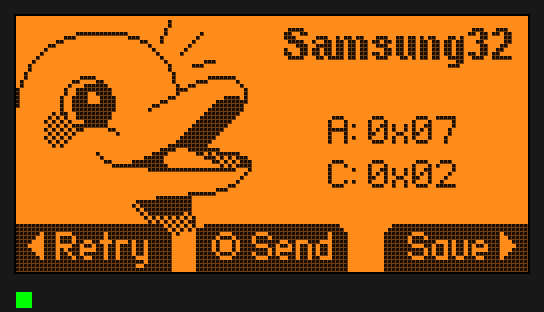 | `./flipperemu ir Samsung32 0x07 0x02` with the Infrared app's Learn screen open |

Transmissions go the other way. Whatever the Flipper sends through its IR LED (a saved
remote, a universal remote, `ir tx NEC 04 08` on the CLI) is written to
`devices/NAME/ir-tx/tx-NNNNN.ir` as a raw signal. A real Flipper can play that file, and
`./flipperemu ir devices/NAME/ir-tx/tx-00001.ir` sends it back into the receiver:

```
Filetype: IR signals file
Version: 1
#
name: tx_00001
type: raw
frequency: 38004
duty_cycle: 0.330166
data: 8999 4499 553 579 553 553 553 1710 553 553 …
```

The durations are whole carrier periods (26.3 µs at 38 kHz), as the LED sends them.

### Sub-GHz

```sh
./flipperemu subghz garage.sub                  # a RAW capture, at the file's frequency
./flipperemu subghz princeton 0x95D5D4          # a PT2262 fixed code (default 433.92 MHz)
./flipperemu subghz raw 390 -1170 1170 -390 … --freq 315
```

The signal goes "on the air". The emulated CC1101 only hears it while it's in RX and
tuned within 500 kHz, as a real radio would, and it reports a strong RSSI during the
burst. Open Sub-GHz → Read (or Read RAW, or run `subghz rx 433920000 0` on the CLI) and
the firmware's own decoders take it from there:

| | |
|:-:|:-:|
| 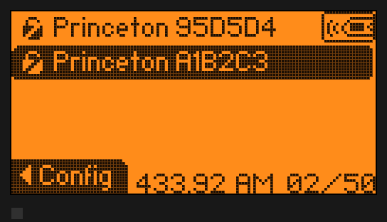 | Sub-GHz → Read after `./flipperemu subghz princeton 0x95D5D4` and a RAW `.sub` capture |

Key files are encoded for Princeton. For other protocols, use a RAW capture (Read RAW
on a real Flipper records one).

Transmissions go the other way. Whatever the emulated Flipper sends (Sub-GHz → Send, a
saved signal, `subghz tx …` on the CLI) is written to `devices/NAME/subghz-tx/tx-NNNNN.sub`.
That file can go straight back in with `./flipperemu subghz` (decoded exactly), or onto a
real Flipper:

```
Filetype: Flipper SubGhz RAW File
Frequency: 433920000
Preset: FuriHalSubGhzPresetCustom
Custom_preset_module: CC1101
Custom_preset_data: 02 0D 03 07 08 32 0B 06 10 17 11 32 12 30 … 00 00 00 C0 00 00 00 00 00 00
Protocol: RAW
RAW_Data: 1170 -390 390 -1170 390 -1170 1170 -390 …
```

#### Real radios

A real SDR can be the emulated CC1101's antenna, so the firmware hears the real band:

```sh
rtl_tcp -a 127.0.0.1 &                          # an RTL-SDR (here, or on another machine)
./flipperemu subghz --sdr rtl_tcp               # until ^C; rtl_tcp:HOST:PORT for elsewhere
./flipperemu subghz --sdr hackrf                # a HackRF One (libhackrf)
./flipperemu subghz --sdr remote_433.92M_250k.cu8 --loop    # a recording (rtl_sdr: cu8)
rtl_sdr -f 434.432M -s 2.048M - | ./flipperemu subghz --sdr - --center 434.432M --rate 2.048M
```

The CC1101 model announces its receive set-up whenever the firmware changes it: RX or
not, frequency, modulation, channel bandwidth, data rate, deviation, OOK decision
boundary. The bridge (`scripts/fe_sdr.py`, numpy) does what the chip would with that
antenna:

- It filters the channel out of the SDR's band at the CC1101's bandwidth, and demodulates
  it. OOK is sliced at the chip's decision boundary below the peak (8 dB in the Flipper's
  presets); 2-FSK by the discriminator. A squelch (`--squelch`, 12 dB) keeps noise off
  GDO0.
- It streams the result to GDO0 as a continuous timeline, which the model plays through a
  60 ms jitter buffer. The firmware's own drivers capture it as they would the real chip's
  output.
- It sends the band's power every 50 ms. The firmware's RSSI reads come from it at
  whatever frequency and bandwidth it asks for, so the Frequency Analyzer finds real
  transmitters, Read RAW shows their RSSI, and hopping stops where there is a signal.
  `--rssi-offset` matches a real Flipper's readings.
- It retunes the SDR when the firmware stays tuned outside its band for half a second, a
  quarter of the sample rate above the channel, clear of the DC spike. `--center` picks
  the band to start with (433.92 MHz by default), `--no-follow` keeps it there.

| | |
|:-:|:-:|
| 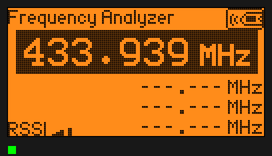 | 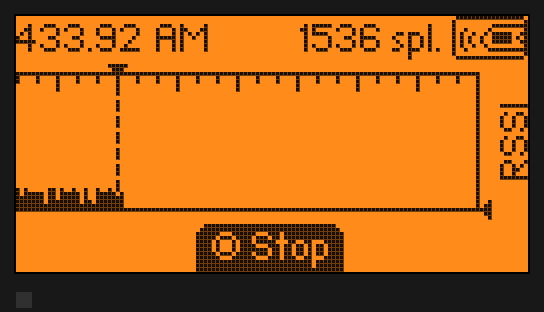 |
| Frequency Analyzer on a simulated RTL-SDR (`rtl_tcp`), a remote at 433.95 MHz | Read RAW recording the same remote through the bridge |

Real recordings from the rtl_433 test corpus (PT2262, EV1527, a TE275 remote, a KeeLoq
HCS200) played through the bridge decode in the firmware's own `subghz rx`, matching
rtl_433's results. `scripts/sdr_check.py DEVICE` checks the bridge with no radio. It
covers the DSP on synthetic OOK and 2-FSK, a recording, and a simulated `rtl_tcp` dongle
the bridge has to retune; `sdr_check.py rtl-tcp-sim` runs that simulator by hand. The
link is a line protocol on `devices/NAME/subghz.sock`, documented in
[docs/RADIO_LINK.md](docs/RADIO_LINK.md), so other radios and tools can drive it.

Receive only for now: the emulated Flipper's transmissions reach the bridge (it prints
them), but nothing goes out over the air. Packet-mode presets (the CC1101's FIFO: MSK,
GFSK at 100 kBaud) aren't received.

### 125 kHz RFID

```sh
./flipperemu rfid EM4100 DE AD BE EF 01        # an EM-Micro EM4100 (RF/64)
./flipperemu rfid H10301 01 02 03              # HID Prox 26-bit, FC 1, card 515 (FSK)
./flipperemu rfid Indala26 11 22 33 40         # Indala 26-bit (PSK)
./flipperemu rfid badge.rfid                   # a Flipper .rfid key file
./flipperemu rfid none                         # take the tag away
./flipperemu rfid --list                       # every protocol
```

The tag stays in the field until you take it away, like a card lying on the Flipper. It
answers whenever the firmware's reader powers it: 125 kHz RFID → Read, Read RAW, or
`rfid read` on the CLI. The waveforms come from ports of the firmware's own protocol
encoders, so its decoders see what a real tag sends. With no tag in the field, the
reader sees noise, as on hardware, and switches between ASK and PSK every 2.5 s.

All 24 protocols of the official firmware are supported:
- ASK: EM4100 (RF/64, /32, /16), Electra, FDX-B, Viking, Jablotron, PAC/Stanley,
  Gallagher, Radio Key, GProxII, Noralsy.
- FSK: H10301, HIDProx, HIDExt, IoProxXSF, AWID, FDX-A, Pyramid, Paradox.
- PSK: Indala26, Keri, Nexwatch, Idteck.

Data is the protocol's bytes as a `.rfid` file holds them (`Data:`).

| | |
|:-:|:-:|
| 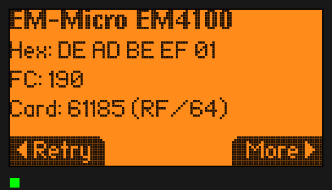 | 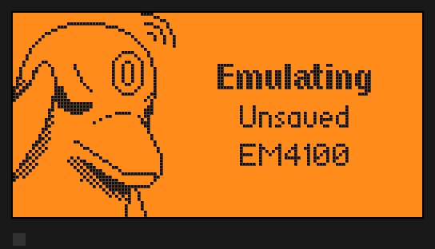 |
| 125 kHz RFID → Read after `./flipperemu rfid EM4100 DE AD BE EF 01` | Emulate: a virtual reader records the tag to `rfid-tx/` |

Emulation goes the other way. When the Flipper emulates a tag (Emulate in the app, or
`rfid emulate EM4100 DEADBEEF01` on the CLI), a virtual 125 kHz reader powers it and
records the load it switches. The recording is in carrier cycles, saved to
`devices/NAME/rfid-tx/tx-NNNNN.txt` once the field goes quiet. Hold that capture to a
reading Flipper with `./flipperemu rfid devices/NAME/rfid-tx/tx-00001.txt` and its
reader decodes it. That works for any protocol your firmware can emulate, including ones
`fe_rfid.py` has no encoder for.

Writing needs a tag that can be written:

```sh
./flipperemu rfid t5577                        # a blank T5577 (factory configuration)
# then on the Flipper: 125 kHz RFID -> Saved -> a key -> Write, or `rfid write H10301 2A1F7B`
./flipperemu rfid                              # shows the T5577's blocks and configuration
```

The T5577 decodes the firmware's write commands from the gaps in the reader's field, as
the real chip does. It stores the blocks, then answers in the modulation and bit rate
that block 0 sets. The firmware's Write only reports success after reading the tag back
and comparing it, so a "Success!" is a full round trip. A password-protected T5577 (block
0's PWD bit, password in block 7) refuses writes without it, and every write and refusal
is logged. `./flipperemu rfid t5577 BLOCK0 … BLOCK7` puts back a T5577 saved that way.

`scripts/rfid_check.py DEVICE` runs three checks for every protocol: the Python encoder
against the firmware's emulation, the Python tag through `rfid read`, and `rfid write`
onto a blank T5577.

| | |
|:-:|:-:|
| 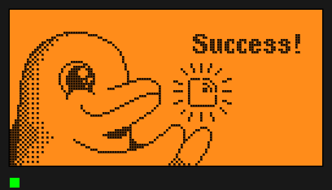 | 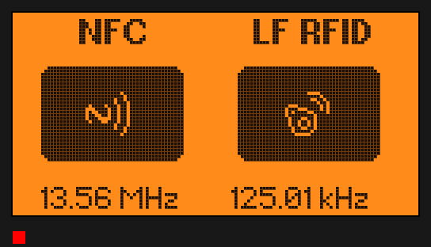 |
| 125 kHz RFID → Saved → Write onto the virtual T5577, verified by the firmware | Momentum's NFC/RFID detector in the virtual readers' fields |

The Flipper sits in a virtual reader's 125 kHz field by default. That field powers
emulated tags, and field detection reads its frequency. `./flipperemu rfid --reader off`
takes it away, and `./flipperemu nfc --field on|off` does the same for a 13.56 MHz
reader's field.

### iButton

```sh
./flipperemu ibutton ds1990 01 A1 B2 C3 D4 E5 F6    # a DS1990A (7 bytes: the CRC is added)
./flipperemu ibutton key.ibtn                       # a Flipper .ibtn file
./flipperemu ibutton ds1996 0C A1 B2 C3 D4 E5 F6    # a DS1996, 8 KB of memory (zeroed)
./flipperemu ibutton cyfral A1 B2                   # a Cyfral key
./flipperemu ibutton metakom C3 55 33 0F            # a Metakom key (each byte: even parity)
./flipperemu ibutton none                           # take it away
```

| | |
|:-:|:-:|
| 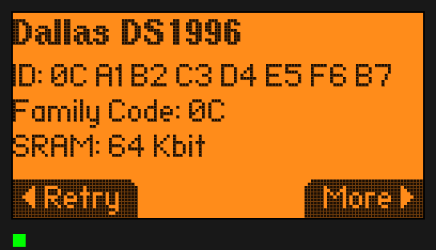 | 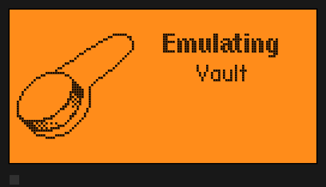 |
| iButton → Read after `./flipperemu ibutton ds1996 0C A1 B2 C3 D4 E5 F6` | Emulate: a virtual reader reads the key, all 8 KB of memory |

The key stays on the contact until you take it away: iButton → Read, or `ikey read` on
the CLI. Dallas keys are 1-Wire slaves on PB14. They answer the firmware's master with
presence pulses, SEARCH ROM, READ ROM, MATCH and SKIP ROM. Memory keys also answer READ
MEMORY: a DS1992 or DS1971 at standard speed, a DS1996 at overdrive speed, as the
firmware reads it. Cyfral and Metakom keys are read through the comparator, as on the
real board, from waveforms that `scripts/fe_ibutton.py` makes with ports of the
firmware's encoders.

Writing needs a blank:

```sh
./flipperemu ibutton rw1990          # an RW1990.1 blank (also rw1990.2, tm2004, tm01x)
# then on the Flipper: iButton -> Saved -> a key -> Write, or `ikey write Dallas 015A6B7C8D9EAF84`
./flipperemu ibutton                 # the blank's ROM now
```

The firmware tries each blank protocol in turn (RW1990.1, RW1990.2, TM2004, TM01x) and
reads the ROM back. Each virtual blank answers only its own protocol, so every path can
be tested.

The other way round, the Flipper emulates a key and a virtual reader reads it:

```sh
# on the Flipper: iButton -> Saved -> a key -> Emulate, or `ikey emulate Dallas 0123456789ABCDE9`
./flipperemu ibutton --reader        # read it: ROM, and all of a DS1992/DS1996/DS1971's memory
# a Cyfral or Metakom emulation is captured by itself:
./flipperemu ibutton devices/NAME/ibutton-tx/tx-00001.txt    # put that key on the contact
```

The reader is a 1-Wire master: READ ROM, then READ MEMORY for a memory key. It saves a
`.ibtn` file to `devices/NAME/ibutton-tx/`, which the Flipper can load. The firmware's
1-Wire slave busy-waits on its own clock with interrupts off, so the reader is paced by
that polling, not by time. When a host stall makes the slave miss a slot (the guest's
clock runs on while the host preempts it), the reader resets it and resumes the memory
read where it stopped, after rereading a few bytes to check the address. A Cyfral or
Metakom emulation is recorded as the firmware sets each level and its period, to
`tx-NNNNN.txt` once 4096 levels are in (well under a second) or the emulation stops;
`scripts/fe_ibutton.py` decodes it. `scripts/ibutton_check.py DEVICE`
reads every kind of key, writes every kind of blank, and emulates every kind of key:
the memory keys with random memory, compared byte for byte.

### NFC

```sh
./flipperemu nfc tag.nfc                                    # a Flipper .nfc dump
./flipperemu nfc ntag215 04F11E7A2C4180 https://flipperzero.one   # a new tag, NDEF URL
./flipperemu nfc mfc1k 11223344                             # a factory MIFARE Classic 1K
./flipperemu nfc none                                       # take it away
```

The card stays in the field until you take it away. Open NFC → Read, or the `nfc`
shell on the CLI (`scanner`, `mfu info`, `dump`, `raw`). The reader gets the same
answers a real card gives. That covers anticollision and select over 4, 7 or 10-byte
UIDs, and GET_VERSION, READ, FAST_READ, READ_SIG, the counters and tearing flags. It
also covers PWD_AUTH with the tag's AUTH0/PROT, and writes. So a password-protected
NTAG reads only as far as AUTH0, and a factory one unlocks with the default password.

| | |
|:-:|:-:|
| 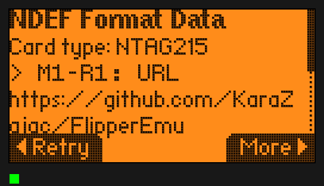 | 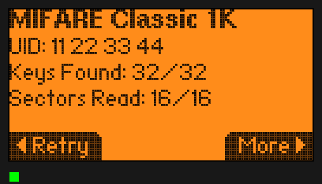 |
| NFC → Read: an NTAG215 and its NDEF URL record | A MIFARE Classic 1K: the dictionary attack finds all 32 keys |

MIFARE Classic cards use Crypto1, written from its published description, with the
nonce PRNG, nested authentication, encrypted parity and the access bits of a real
card. The NFC app's dictionary attack finds the keys that are in its dictionary,
reads what those keys may read, and writes with what they may write. In a `.nfc`
dump, blocks that were never read are zeros, and unknown keys are FF FF FF FF FF FF.

So far: NTAG213/215/216, MIFARE Ultralight and Ultralight EV1 (Type 2), MIFARE
Classic Mini/1K/4K. Other card families are next.

Emulation goes the other way, as with 125 kHz RFID. Start the Flipper emulating a card
(NFC → Saved → a card → Emulate, or `emulate -f /ext/nfc/tag.nfc` in the `nfc` shell),
then hold a reader to it:

```sh
./flipperemu nfc --reader ntag     # read it like a phone reads an NTAG
./flipperemu nfc --reader scan     # only activate it: UID, ATQA and SAK
```

The reader's field wakes the emulation. The ST25R3916 runs anticollision and select by
itself from what the firmware loaded into its passive-target memory, as the real chip
does. After that, each reader command reaches the firmware through the FIFO, and what
the firmware transmits is the answer. `ntag` asks for the version, the signature, every
page and the NFC counter. What the reader read is printed and saved to
`devices/NAME/nfc-tx/read-NNNNN.nfc`, a Flipper `.nfc` file; an `ntag` read can go back
in as a card with `./flipperemu nfc`. To make a file for the Flipper to emulate:

```sh
scripts/fe_nfc.py --nfc-file --ntag215 04A1B2C3D4E5F6 https://flipperzero.one > tag.nfc
```

Or read a virtual card with NFC → Read and save it on the Flipper.

#### A card from a program (the NFC link)

With no card in the field, the Flipper's reader talks to whatever is on the device's
NFC link, `devices/NAME/nfc.sock`. That can be a card written in Python, or a relay to
real hardware:

```sh
./flipperemu nfc none                               # no built-in card in the field
./flipperemu nfc --link iso-dep --verbose           # an ISO14443-4A card, until ^C
./flipperemu nfc --link script:mycard.py            # a card of your own
./flipperemu nfc --link log                         # no card: print the reader's frames
```

Each frame the firmware sends goes out on the link as data bits (CRC included) and the
parity of each byte, so MIFARE Classic's encrypted parity survives. The answer comes
back as the card's. While the program works it out, QEMU stops the machine and the
virtual clock with it. However long the answer takes (a Python card, or USB to a real
reader), the firmware still sees it within its frame waiting time.

`scripts/fe_nfc_link.py` has the layers a card needs:
- `Iso14443A`: REQA/WUPA, anticollision and select over 4, 7 or 10-byte UIDs, HLTA;
- `IsoDep`: RATS/ATS, I-blocks with chaining, R- and S-blocks, and the APDUs handed to
  `apdu()`.

The `iso-dep` card answers SELECT, GET CHALLENGE and GET DATA. The NFC app reads it as an
ISO14443-4A card, and `apdu -p 4a -d 00A4040007A000000003101000` in the `nfc` shell gets
its answers through the firmware's own ISO-DEP stack. A card type the emulator doesn't
model is a subclass and a method away, and so is an answer no real card would give, for
seeing what the firmware's parsers make of it:

```python
import fe_nfc_link as nl

class Mine(nl.IsoDep):
    def apdu(self, cmd):
        return bytes.fromhex("9000")

def card(args):
    return Mine(uid=bytes.fromhex("04112233445566"))
```

| | |
|:-:|:-:|
| 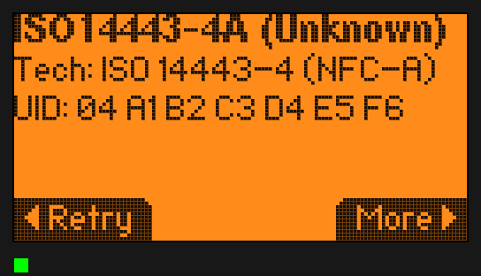 | |
| NFC → Read: the `iso-dep` card, played by `fe_nfc_link.py` over the link | |

The protocol is in [docs/RADIO_LINK.md](docs/RADIO_LINK.md). For now the link is the card
and the firmware the reader. The other way round still uses the built-in virtual reader
(`--reader`).

#### Real cards, through a Proxmark3

```sh
./flipperemu nfc --link pm3                   # the first Proxmark3 found; pm3:/dev/ttyACM1
./flipperemu nfc hf-mf-A1B2C3D4-dump.json     # a card the Proxmark3 dumped, in the field
scripts/fe_nfc.py --nfc-file hf-mfu-dump.json > card.nfc     # and for a real Flipper
```

With `pm3`, every frame the emulated Flipper's reader sends goes out of a real
Proxmark3's antenna, and the real card's answer comes back. That includes anticollision
and select, so what the firmware sees is the card itself. It talks the Proxmark3's own
USB protocol, so no client is needed, against Iceman/RRG firmware:
- From v4.23346 (September 2026) the relay is exact. Each frame goes out as air bits with
  its own parity, and the answer comes back with the card's (`ISO14A_NO_PARITY`), so
  MIFARE Classic's encrypted exchanges get through: the firmware's dictionary attack
  and `dump` run against the real card.
- Older firmware takes the frame's bytes and adds the parity itself, so everything
  relays except Classic after authentication.

Only ISO14443A goes out. The firmware's ISO14443B, FeliCa and ISO15693 polls get
silence. The emulated machine stops while each frame makes the round trip.

A dump is the client's JSON: `hf mf autopwn` or `hf mf dump` for MIFARE Classic Mini, 1K
and 4K (FileType `mfcard`, `mfc v2`, `mfc v3`), and `hf mfu dump` for Ultralight and NTAG
(`mfu`, with version, signature and counters). `scripts/nfc_link_check.py DEVICE` checks
all of it with no Proxmark3. It converts dumps, then relays through a simulated Proxmark3
(`scripts/fe_pm3.py sim`), for both firmware generations. The relay is written from the
Proxmark3 firmware's source and checked against that simulation. It has not met a real
Proxmark3 yet.

### Sound

The speaker plays through QEMU's audio. `--audio` picks the output: by default a desktop
driver if your QEMU build has one (PipeWire, PulseAudio, ALSA or SDL; silent when
`--headless`). `wav:FILE` records instead, which works everywhere:

```sh
./flipperemu run --audio wav:flipper.wav     # e.g. then: ./flipperemu cli "buzzer note C5 1s"
```

### Battery and USB power

The fuel gauge and charger are live QOM objects. From the monitor
(`scripts/fe_monitor.py devices/NAME/monitor.sock hmp "…"`):

```
qom-set /machine/gauge soc 5           # 5 % battery: low-battery warnings
qom-set /machine/gauge temperature-dk 3330   # 60 °C
qom-set /machine/charger usb true      # plug in a charger (charging icon)
qom-set /machine/soc/usb attached false   # pull the USB cable (data and VBUS)
```

With `--usb` (the default) the virtual cable is plugged in, so the Flipper shows
charging. As on hardware, a Flipper on USB never enters deep sleep: expect about 20 % of
a host core while idle, against 1–2 % with `--usb none` or the cable pulled.

### The secure enclave

A Flipper keeps its keys where its firmware cannot read them: in the key store of ST's
FUS, on the radio core. The firmware names a slot, the FUS puts that key into the AES
peripheral, and the firmware encrypts with a key it never sees. The emulated machine has
both halves, so the firmware's check of its factory keys passes at every start, and what
is built on `furi_hal_crypto` runs: the CLI's `crypto` commands, U2F's key and counter
files, apps that keep secrets.

| slot | |
|---|---|
| 0 | the master key: it only decrypts keys that are delivered encrypted, and can never be loaded |
| 1–10 | the factory keys, the same on every device (1 encrypts the Sub-GHz keystores, 2 the stock U2F certificate's key) |
| 11 | the device's own key, which the firmware makes from random bytes the first time one is needed (U2F does) |
| 12–100 | what apps and `crypto store_key` add, one after the other |

```sh
./flipperemu enclave                  # this device's keys, and how many the firmware accepts
./flipperemu cli "crypto has_key 1"   # the firmware's side: Successfully loaded key from slot 1
./flipperemu cli                      # then e.g.: crypto encrypt 1 000102030405060708090a0b0c0d0e0f
./flipperemu enclave encrypt 1 000102030405060708090a0b0c0d0e0f "fifteen chars.."   # the same, computed here
./flipperemu enclave decrypt 1 000102030405060708090a0b0c0d0e0f HEX
./flipperemu enclave wrap KEY         # KEY under the master key, for
                                      # `crypto store_key 12 encrypted 256 …`
./flipperemu enclave reset            # the factory keys again (device stopped)
./flipperemu enclave blank            # no keys at all: the firmware reports a damaged enclave
```

(`crypto encrypt` encrypts its text in whole blocks, and fills the last one with whatever
followed the text in the firmware's memory. A text of 15, 31, 47… characters leaves no
room for that, and only then is the ciphertext the same every time, and the same as
computed here.)

The keys are in `devices/NAME/enclave.keys`, one per line, yours to read and to edit
while the device is stopped. As on the chip, a key is written once, in the next free
slot: the firmware cannot change or remove one. The file is rewritten when it stores
one.

**The factory keys are FlipperEmu's own, and they are public.** Flipper Devices' keys
never leave a real Flipper and are not in this project. Every emulated Flipper gets
`SHA-256("FlipperEmu enclave key N")` in their place. Two things follow:

- Nothing an emulated Flipper encrypts is secret, because anybody can compute its keys.
  That suits development and testing. Don't register an emulated U2F token with an
  account that matters.
- What a real Flipper's keys encrypted stays closed. The stock Sub-GHz keystore
  (`/ext/subghz/assets/keeloq_mfcodes`) decrypts to noise: the firmware logs
  `Failed to load line` for each line and carries on without those manufacturer codes.
  The stock U2F certificate's private key is encrypted the same way, so the
  certificate of an emulated token does not match the key it signs with.

Manufacturer codes of your own go where they go on a real Flipper: in
`/ext/subghz/assets/keeloq_mfcodes_user`, in plain text (`keeloq_mfcodes_user.example`
beside it shows the format). The firmware can also encrypt such a file the way the stock
one is: after `sysctl debug 1`, `subghz encrypt_keeloq PLAIN_FILE ENCRYPTED_FILE IV`
(the IV as 16 bytes of hex) writes a keystore under key 1, which this emulated Flipper
reads and no real one does.

The firmware's own check of the enclave encrypts one block with each factory key and
compares it with a ciphertext that only the real key gives. For those ten blocks, and
for nothing else, the emulated enclave answers what the firmware expects; the expected
values are in the firmware's source. Every other block is plain AES with the key in the
file. Put a key of your own in a factory slot and that slot fails the check, as a wrong
key would on hardware.

| | |
|:-:|:-:|
| 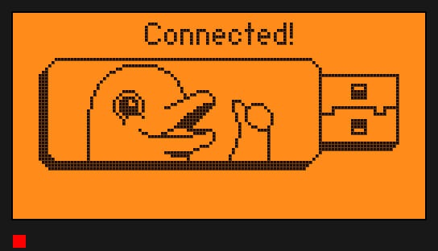 | 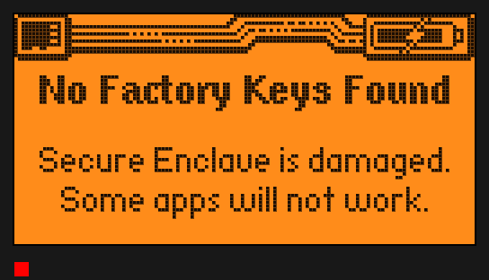 |
| U2F, which needs the ten factory slots filled, and makes the device's own key | After `./flipperemu enclave blank`: the firmware finds no factory keys |

### Debugging firmware

```sh
./flipperemu run --wait-gdb -f build/f7-firmware-D/firmware.elf     # halts at reset
./flipperemu gdb                                                     # second terminal
(gdb) break furi_hal_subghz_init
(gdb) continue
```

QEMU's own `-d` tracing works too. `scripts/fe_monitor.py` drives the HMP monitor
(`devices/NAME/monitor.sock`) for screenshots, key presses and `info registers`.

### Running QEMU by hand

```sh
build/qemu/qemu-system-arm -M flipper-zero,name=Qemu,nvram=nv.bin,usb-serial=usb \
    -chardev pty,id=usb \
    -drive if=pflash,format=raw,file=flash.img \
    -drive if=sd,format=raw,file=sd.img \
    -rtc base=localtime -serial stdio
# or simply: -M flipper-zero -kernel firmware.elf   (volatile flash, no USB)
```

Machine options: `name=` (OTP device name, ≤8 chars), `lcd-scale=`, `region=` (OTP
region), `legacy-sleep=on|off` (default off: STOP2), `nvram=`, `usb-serial=` (chardev id for the USB port;
plugs the cable in), `audiodev=` (the speaker's `-audiodev` id). `-global
stm32wb55-usb.debug=on` traces the USB host.

## Layout

```
RESEARCH.md            prior-art survey (who else has done this, and how)
PLAN.md                roadmap
docs/ARCHITECTURE.md   how the machine is modelled, device by device
docs/BRINGUP_LOG.md    every bug found on the way (incl. 3 QEMU fixes and the USB races)
docs/RADIO_LINK.md     the protocol between an emulated radio and a real one
flipperemu             launcher / device manager
qemu/hw/arm/flipper/   the QEMU machine + STM32WB55 SoC + board devices (C)
qemu/patches/          fixes to upstream QEMU (SysTick, ssi-sd, SD SPI state)
scripts/               setup_qemu.sh, fetch_firmware.py, make_sdcard.py, fe_monitor.py,
                       fe_cli.py, fe_ir.py, fe_subghz.py, fe_sdr.py (real radios),
                       fe_nfc_link.py (cards from programs), fe_pm3.py (Proxmark3),
                       fe_enclave.py (the enclave's keys and ciphers), fe_usbip.py,
                       usbip_attach.py, smoke_test.py, *_check.py
devices/ firmware/ build/ third_party/    generated, git-ignored
```

## Licence

- FlipperEmu's own code (the machine and device models in `qemu/hw/arm/flipper/`,
  the launcher, scripts and docs) is **BSD-3-Clause**; see [LICENSE](LICENSE).
- The patches in `qemu/patches/` change QEMU's own source files, so they are
  **GPL-2.0-or-later** like those files; see [qemu/patches/README.md](qemu/patches/README.md).
- The `qemu-system-arm` you build is QEMU, a GPL-2.0 program that includes these
  BSD-3 files. If you distribute that binary, the GPL-2.0 applies to it.
- No code was taken from other Flipper emulators (see [RESEARCH.md](RESEARCH.md)). The
  firmware's behaviour was learned by reading its source, which is GPL-3.0; none of its
  code is copied here. One table of numbers is: the IVs, inputs and expected
  ciphertexts of its enclave self-test (`qemu/hw/arm/flipper/flipper_enclave.c`), which
  the emulated enclave has to answer with.
- Screenshots show firmware UI artwork that belongs to its authors (Flipper Devices,
  Momentum). Flipper Zero is a trademark of Flipper Devices Inc. This project is not
  affiliated with or endorsed by them.
