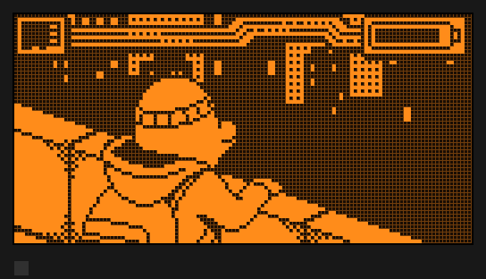
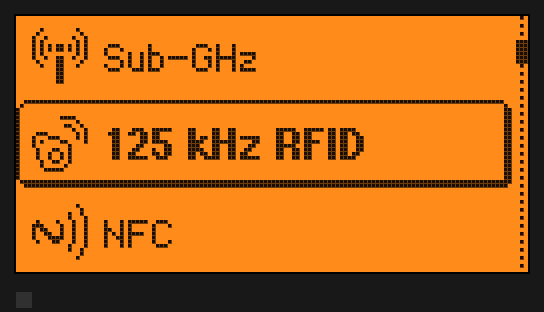
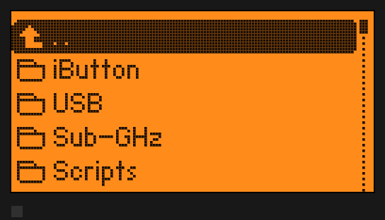
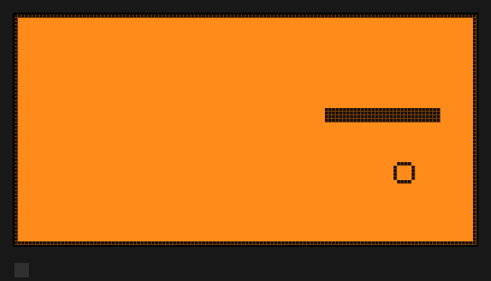
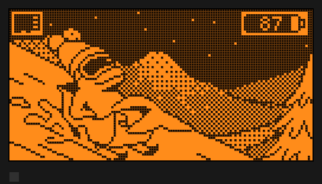
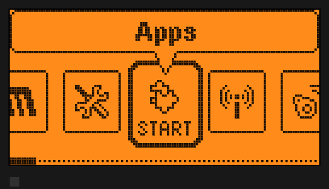
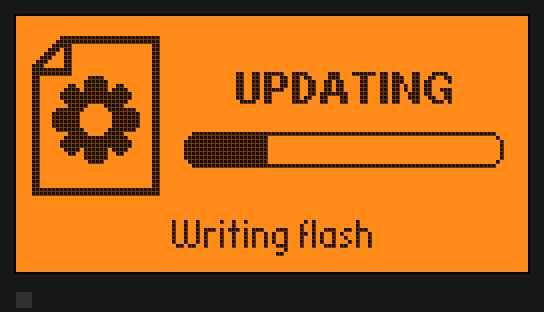
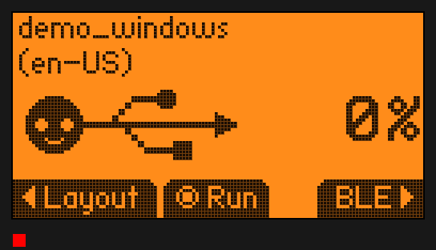

# FlipperEmu

Run real Flipper Zero firmware on your PC, so you can try builds without flashing your
Flipper. This is a full-system emulator built on **QEMU 11.1.3**. The machine model is a
new `flipper-zero` board (STM32WB55RG SoC with the Flipper's display, SD card, power ICs
and radios), and it runs the **unmodified firmware binary**: the same `.elf`, `.dfu` or
update `.tgz` you would flash.

| | |
|:-:|:-:|
|  |  |
| Desktop: dolphin animation streamed from the emulated microSD | Main menu, driven by keyboard / `press` |
|  |  |
| `/ext/apps` browser | `snake_game.fap` loaded from SD and running |

Why build another one? See [RESEARCH.md](RESEARCH.md). Three other emulators that run real
firmware appeared in 2026 (dryflash-FZ, plus two Renode projects), but none is built on
QEMU, so none has QEMU's speed, built-in GDB stub, snapshots or tracing plugins.

## Status

Verified on 2026-11-07 with `scripts/smoke_test.py` (headless boot, SD mount, LCD, input,
CLI over USB, no crash): **official 1.5.1**, **Momentum mntm-012**, **Unleashed unlshd-094**.

| | |
|:-:|:-:|
|  |  |
| Momentum desktop (battery 87 % from the emulated fuel gauge) | Momentum's Apps carousel |

**Works**
- Boots to the desktop: every `furi_hal` init, all services, the dolphin and the menus.
- 128×64 ST7567 LCD with backlight, plus RGB LED and vibro indicators in the window.
- Buttons from the keyboard, the QEMU monitor, or `./flipperemu press`.
- microSD over SPI2 + DMA: card detect, mount, read, write. Settings land in
  `/ext/.int`, dolphin animations load from the card, and `.fap` apps launch.
- Persistent devices: the internal flash (`flash.img`) and the battery-backed state (fuel
  gauge data memory and RTC backup domain, `nvram.bin`) survive restarts.
- USART1 log console (`[I][Flipper] Startup complete`, …) on stdio, a file, a pty or TCP.
- Over-the-air updates through the firmware's own updater (`run --update`): /int backup,
  updater in RAM, flash write and verify, resources and splash, then a normal boot.
- USB: the firmware enumerates on a built-in virtual host. Its USB serial port (the CLI
  and the protobuf RPC) is bridged to a pty or socket, and `./flipperemu cli` talks to
  it. When an app switches the port to HID (Bad USB, USB remote), the host plays the
  PC and shows what the Flipper types.
- CPU2 modelled as ST's FUS with no wireless stack. That's a real device state, and it
  keeps the crypto-enclave and BT paths healthy.
- Sub-GHz CC1101 self-test passes (`Init OK`) and the NFC ST25R3916 initialises (chip ID,
  oscillator, VDD measurement). Both are register-level only, with no RF.
- GDB stub with the release `.elf` symbols.

**Not yet** (see [PLAN.md](PLAN.md))
- qFlipper and lab.flipper.net: they look for a USB device (VID/PID), not a serial
  port, so they don't see the emulator yet (a USB/IP bridge would fix that). Tools that
  open a serial port path work.
- Bluetooth (needs a radio stack), and RF signals for Sub-GHz, NFC, RFID, IR and iButton.
- Speaker audio. LP5562 engine programs are approximated (steady-state brightness only).
- Not yet exercised: XIP app loaders that run code from internal flash, and the
  radio-stack stage of updates (the emulated CPU2 can't install a stack).
- The GTK window is QEMU's standard display. It hasn't been tested on a desktop session
  here; all testing so far was headless, with screenshots taken through the monitor.

You'll see "No Factory Keys Found / Secure Enclave is damaged" on the first screen. That
is the firmware's own message: the per-device factory keys only exist inside a real
Flipper's CPU2. Press Back.

## Quick start

```sh
# 1. build QEMU with the Flipper machine (about 6 min the first time; no root needed:
#    needs gcc, ninja, python3, glib2/pixman/gtk3 headers)
scripts/setup_qemu.sh

# 2. fetch an official release (SHA-256 verified)
scripts/fetch_firmware.py                     # -> firmware/official-<ver>/

# 3. flash and boot. The update package also provides the SD card resources.
./flipperemu run -f firmware/official-1.5.1/flipper-z-f7-update-1.5.1.tgz
```

The window shows the LCD. Use the **arrows**; **Enter/Space** is OK and
**Backspace/Esc** is Back. The firmware log streams to the terminal.

### Your own builds and other firmwares

```sh
./fbt                                          # in your firmware tree
./flipperemu -d mine run -f ~/flipperzero-firmware/build/f7-firmware-D/firmware.elf
# or a whole update package (firmware + SD resources), e.g. a release or the
# one `./fbt updater_package` puts in dist/f7-*/:
./flipperemu -d mntm run -f flipper-z-f7-update-mntm-012.tgz
```

Each `-d NAME` is an independent virtual Flipper in `devices/NAME/`, with its own flash, SD
card and NVRAM. Re-running with `-f` reflashes it the way DFU does (only the touched pages
are erased). Without `-f` it boots whatever is already flashed.

## The `flipperemu` tool

| command | what it does |
|---|---|
| `run [-f FW] [--headless] [--gdb\|--wait-gdb] [--serial S] [--usb U] [--no-sd]` | (flash and) boot |
| `run --update PKG` | install an update package through the firmware's own updater (keeps settings and files) |
| `stop` | shut a running device down cleanly (saves its NVRAM) |
| `cli ["CMD" …]` | the device's CLI over USB: interactive, or run commands and print their output |
| `flash FW [--erase-all]` | program `.elf` / `.dfu` / `.bin` / update `.tgz` into `flash.img` |
| `sd [--resources X] [--size 512M]` | rebuild the microSD from a resources tgz, update package or folder |
| `press ok down down ok …` | press buttons on a running device |
| `shot out.png` | save the LCD of a running device |
| `gdb` | attach gdb (with symbols when the device was flashed from an `.elf`) |
| `info` | which firmware is on the device |

`--serial` (the USART1 log) takes `stdio` (default), `file:PATH`, `pty`, `tcp:PORT` or
`null`. `--usb` (the USB serial port) takes `pty` (default), `unix`
(`devices/NAME/usb.sock`), `tcp:PORT` or `none` (cable unplugged). Anything after `--` is
passed straight to QEMU, e.g. `-- -icount shift=auto` for deterministic timing, or
`-- -d in_asm,cpu -D trace.log`.

### Smoke-testing a build

```sh
scripts/smoke_test.py path/to/firmware.elf|.dfu|update.tgz [--no-sd]
```

Boots a throwaway device headless and checks: "Startup complete", "card mounted", the
LCD draws, OK changes the screen, `info device` answers on the USB CLI, the LCD comes back
after `power reboot`, and no `[CRASH]` in the log. Exit code 0 means pass, so
it slots into a pre-flash habit or CI.

### Updating like qFlipper does

`-f` writes a firmware straight into the flash, like a DFU flash. `--update` installs an
update package the way a real Flipper does. The firmware backs up `/int`, reboots into
its updater in RAM, writes and verifies the flash, then unpacks the new resources onto the
card. Your settings and files stay:

```sh
./flipperemu -d mine run --update firmware/momentum-mntm-012/flipper-z-f7-update-mntm-012.tgz
```

| | |
|:-:|:-:|
|  | The stock updater writing the emulated flash. The radio stage of the package is left out: the emulated CPU2 is a FUS without a radio stack and can't install one. |

### USB: CLI, RPC and Bad USB

```sh
./flipperemu run …        # prints: USB serial (CLI/RPC): /dev/pts/7 -> devices/default/usb.tty
./flipperemu cli          # interactive CLI session; Ctrl-] quits
./flipperemu cli "info device" "storage list /ext" "loader open /ext/apps/USB/bad_usb.fap"
screen devices/default/usb.tty      # or minicom, picocom, a pyserial script, …
```

Connecting raises DTR and the firmware starts a CLI session, the same as `/dev/ttyACM0` on a
real Flipper; disconnecting ends it. `start_rpc_session` switches the same port to the
protobuf RPC, so tools that open a serial port by path work against the emulator.

When an app turns the port into a USB keyboard (Bad USB, the USB remote), the virtual
host acts as a PC with a US layout, and what the Flipper types appears as text on the
same port. Key combinations are shown the way DuckyScript writes them. Bad USB's
`demo_windows` starts like this:

```
<GUI r>notepad
Hello World!
<UP><HOME><SHIFT DOWN><CTRL c><RIGHT><CTRL v><CTRL v><ALT 7>This line was print using Alt+Numpad input method. …
```

| | |
|:-:|:-:|
|  | Bad USB with the emulator's host as the "PC": the script runs to 100 %, and its keystrokes show up on `devices/NAME/usb.tty` |

### Battery and USB power

The fuel gauge and charger are live QOM objects. From the monitor
(`scripts/fe_monitor.py devices/NAME/monitor.sock hmp "…"`):

```
qom-set /machine/gauge soc 5           # 5 % battery: low-battery warnings
qom-set /machine/gauge temperature-dk 3330   # 60 °C
qom-set /machine/charger usb true      # plug in a charger (charging icon)
qom-set /machine/soc/usb attached false   # pull the USB cable (data and VBUS)
```

With `--usb` (the default) the virtual cable is plugged in, so the Flipper shows
charging.

### Debugging firmware

```sh
./flipperemu run --wait-gdb -f build/f7-firmware-D/firmware.elf     # halts at reset
./flipperemu gdb                                                     # second terminal
(gdb) break furi_hal_subghz_init
(gdb) continue
```

QEMU's own `-d` tracing works too. `scripts/fe_monitor.py` drives the HMP monitor
(`devices/NAME/monitor.sock`) for screenshots, key presses and `info registers`.

### Running QEMU by hand

```sh
build/qemu/qemu-system-arm -M flipper-zero,name=Qemu,nvram=nv.bin,usb-serial=usb \
    -chardev pty,id=usb \
    -drive if=pflash,format=raw,file=flash.img \
    -drive if=sd,format=raw,file=sd.img \
    -rtc base=localtime -serial stdio
# or simply: -M flipper-zero -kernel firmware.elf   (volatile flash, no USB)
```

Machine options: `name=` (OTP device name, ≤8 chars), `lcd-scale=`, `region=` (OTP
region), `legacy-sleep=on|off`, `nvram=`, `usb-serial=` (chardev id for the USB port;
plugs the cable in). `-global stm32wb55-usb.debug=on` traces the USB host.

## Layout

```
RESEARCH.md            prior-art survey (who else has done this, and how)
PLAN.md                roadmap
docs/ARCHITECTURE.md   how the machine is modelled, device by device
docs/BRINGUP_LOG.md    every bug found on the way (incl. 3 QEMU fixes and the USB races)
flipperemu             launcher / device manager
qemu/hw/arm/flipper/   the QEMU machine + STM32WB55 SoC + board devices (C)
qemu/patches/          fixes to upstream QEMU (SysTick, ssi-sd, SD SPI state)
scripts/               setup_qemu.sh, fetch_firmware.py, make_sdcard.py, fe_monitor.py,
                       fe_cli.py, smoke_test.py
devices/ firmware/ build/ third_party/    generated, git-ignored
```

## Licence

- FlipperEmu's own code (the machine and device models in `qemu/hw/arm/flipper/`,
  the launcher, scripts and docs) is **BSD-3-Clause**; see [LICENSE](LICENSE).
- The patches in `qemu/patches/` change QEMU's own source files, so they are
  **GPL-2.0-or-later** like those files; see [qemu/patches/README.md](qemu/patches/README.md).
- The `qemu-system-arm` you build is QEMU, a GPL-2.0 program that includes these
  BSD-3 files. If you distribute that binary, the GPL-2.0 applies to it.
- No code was taken from other Flipper emulators (see [RESEARCH.md](RESEARCH.md)). The
  firmware's behaviour was learned by reading its source, which is GPL-3.0; none of it
  is copied here.
- Screenshots show firmware UI artwork that belongs to its authors (Flipper Devices,
  Momentum). Flipper Zero is a trademark of Flipper Devices Inc. This project is not
  affiliated with or endorsed by them.
